<div align="center">

# devsecops-pipeline

**Cada commit: probado, firmado y desplegado.**

Pipeline CI/CD seguro de punta a punta: imágenes multi-arquitectura, seguridad de la cadena
de suministro, pruebas E2E en Kubernetes en cada pull request y despliegue GitOps.

[](https://github.com/EA-etn/devsecops-pipeline/actions/workflows/ci.yml)
[](https://github.com/EA-etn/devsecops-pipeline/releases)
[](LICENSE)


[English](README.md) · **Español**



</div>

## Por qué este proyecto

El proyecto es el **pipeline**. La aplicación que entrega, **`demo-api`**, es deliberadamente mínima
(unos pocos endpoints JSON en FastAPI): es el pasajero. Lo importante es todo lo que la rodea, las
mismas prácticas que usa un equipo de plataforma para entregar software de forma segura.

- **Nada roto llega a `main`:** cada pull request ejecuta tests, escaneos de seguridad y un
  despliegue real en un clúster de Kubernetes de 3 nodos.
- **Cada imagen es verificable:** escaneada con Trivy, publicada con SBOM y procedencia, y
  firmada con Cosign, sin claves que gestionar.
- **Git es la fuente de verdad:** el pipeline escribe la versión exacta a desplegar y ArgoCD
  sincroniza el clúster desde Git.

## Qué incluye

| Área | Qué obtienes |
|---|---|
| 🐳 **Contenedor** | Build multi-stage · usuario sin privilegios · healthcheck · `amd64` + `arm64` (funciona en una Raspberry Pi) |
| 🔐 **DevSecOps** | Trivy (deps, secretos, misconfig, imagen) · SBOM · procedencia SLSA · Cosign keyless · Dependabot · actions fijadas por SHA |
| ☸️ **Kubernetes** | Helm chart con Pod Security *restricted*, probes, PDB, HPA, topology spread y `helm test` |
| 🧪 **CI** | E2E en un **clúster k3s efímero de 3 nodos** en cada PR, con rolling update sin caída |
| 🔄 **GitOps** | Commit automático del tag de imagen tras cada merge + `Application` de ArgoCD (auto-sync, self-heal, prune) |
| 📊 **Observabilidad** | Endpoint `/metrics` en formato Prometheus |

## Inicio rápido

```bash
docker run -p 8000:8000 ghcr.io/ea-etn/demo-api:0.2.0
curl localhost:8000/info
```

O desde el código:

```bash
make install   # entorno virtual + dependencias
make test      # tests
make run       # http://localhost:8000/docs
make help      # todos los comandos
```

| Endpoint | Descripción |
|---|---|
| `/health` | Health check (Docker `HEALTHCHECK` y probes de Kubernetes) |
| `/info` | Hostname (= nombre del pod), versión y hora UTC |
| `/metrics` | Métricas Prometheus (peticiones, latencias, códigos) |
| `/docs` | Documentación interactiva (Swagger) |

## Arquitectura

### Pipeline CI/CD



### Seguridad de la cadena de suministro



### Despliegue en Kubernetes



> Los diagramas son código: HTML + iconos [Lucide](https://lucide.dev), exportados a SVG animado.
> Ver [`docs/diagrams/src`](docs/diagrams/src).

## Verificar una imagen

Cualquiera puede comprobar que una imagen la construyó este pipeline y que no fue alterada:

```bash
cosign verify ghcr.io/ea-etn/demo-api:0.2.0 \
  --certificate-identity-regexp '^https://github.com/EA-etn/devsecops-pipeline/\.github/workflows/ci\.yml@refs/(heads/main|tags/v.*)$' \
  --certificate-oidc-issuer https://token.actions.githubusercontent.com
```

<details>
<summary><b>Más: SBOM, controles de seguridad y puerta de calidad</b></summary>

Ver el SBOM:

```bash
docker buildx imagetools inspect ghcr.io/ea-etn/demo-api:0.2.0 --format '{{ json .SBOM }}'
```

| Control | Herramienta | Cuándo |
|---|---|---|
| Vulnerabilidades en dependencias | Trivy (`fs`) | Cada PR y push |
| Secretos filtrados | Trivy (`secret`) | Cada PR y push |
| Malas configuraciones (Dockerfile, Helm) | Trivy (`misconfig`) | Cada PR y push |
| Vulnerabilidades de la imagen | Trivy (`image`) | PR (imagen local) y `main` (imagen publicada) |
| Inventario de componentes (SBOM) | BuildKit (SPDX) | Cada imagen publicada |
| Procedencia del build | BuildKit (SLSA) | Cada imagen publicada |
| Firma de la imagen | Cosign keyless (Sigstore) | Cada imagen publicada |
| Actualizaciones de dependencias | Dependabot (pip, actions, docker) | Semanal |

Los hallazgos se publican en **Security → Code scanning**. El pipeline **falla** ante cualquier
hallazgo HIGH/CRITICAL con solución disponible.

</details>

## Kubernetes y GitOps

<details>
<summary><b>Probarlo en un clúster k3s local</b> (Docker, <a href="https://k3d.io">k3d</a> y Helm)</summary>

```bash
make cluster          # clúster k3s de 3 nodos
make deploy           # build + import + helm install
make helm-test        # /health, /info y /metrics desde dentro del clúster
make cluster-delete
```

</details>

<details>
<summary><b>Desplegar con ArgoCD</b> (homelab)</summary>

Tras cada merge a `main`, el job `gitops` escribe la versión exacta de la imagen (`sha-xxxxxxx`)
en `chart/demo-api/values-homelab.yaml`. ArgoCD detecta el cambio en Git y lo despliega:
**nadie necesita acceso al clúster para desplegar.**

```bash
kubectl create namespace argocd
kubectl apply -n argocd -f https://raw.githubusercontent.com/argoproj/argo-cd/stable/manifests/install.yaml
kubectl apply -f deploy/argocd/application.yaml
```

| Situación | Qué hace ArgoCD |
|---|---|
| Merge a `main` | Despliega la nueva versión |
| Alguien cambia algo a mano en el clúster | Lo revierte (`selfHeal`) |
| Un recurso se elimina del chart | Lo borra (`prune`) |
| Hay que volver atrás | `git revert` → ArgoCD despliega la versión anterior |

</details>

<details>
<summary><b>Releases y etiquetas de imagen</b></summary>

Publica una release desde GitHub (**Releases → Draft a new release**, tag `vX.Y.Z`).

| Evento | Etiquetas de imagen |
|---|---|
| Pull request | (no se publica) |
| Push a `main` | `main`, `sha-xxxxxxx` |
| Tag `v1.2.3` | `1.2.3`, `1.2`, `sha-xxxxxxx` |

</details>

<details>
<summary><b>Estructura del proyecto</b></summary>

```
.
├── app/                         # Aplicación FastAPI
├── tests/                       # pytest
├── chart/demo-api/            # Helm chart
│   ├── values.yaml              #   valores por defecto
│   └── values-homelab.yaml      #   entorno homelab (actualizado por GitOps)
├── deploy/argocd/               # Application de ArgoCD
├── docs/diagrams/               # Diagramas de arquitectura animados (+ fuente)
├── .github/workflows/ci.yml     # Pipeline CI/CD
├── .github/dependabot.yml       # Actualizaciones automáticas
├── Dockerfile
└── Makefile
```

</details>

## Lecciones aprendidas

Incidentes reales encontrados al construir este proyecto ([infografía](docs/diagrams/es/05-incidents.png)):

| Problema | Causa | Solución |
|---|---|---|
| `docker build` falla con **429 Too Many Requests** | Límite de descargas anónimas de Docker Hub | Usar un mirror (`mirror.gcr.io`) para la imagen base |
| `pip` falla dentro del build: *certificate verify failed* | Un proxy corporativo intercepta HTTPS | Inyectar la CA del proxy **solo** en una etapa de build local, nunca en la imagen final |
| `trivy-action` falla al instalar Trivy | El script de instalación no podía descargar el binario | Ejecutar la imagen oficial de Trivy **fijada por digest** (además, más seguro) |
| El rolling update falla: *annotations: expected string* | El chart no convertía a texto anotaciones numéricas | `quote` en la plantilla; lo detectó el test E2E en k3s |
| En `main` fallan Trivy y Cosign: *could not parse reference* | `github.repository` conserva mayúsculas (`EA-etn`) y Docker exige minúsculas | Normalizar con `${IMAGE,,}`. Los pasos que solo corren en `main` también necesitan cobertura |
| Una release no ejecuta el pipeline | El commit del tag contenía la marca para **omitir CI**; GitHub también la lee del título del PR en el commit de merge | Quitar la marca del commit del bot (los push con `GITHUB_TOKEN` no disparan workflows) y no usarla en títulos de PR |
| `main` falla justo después de un merge: Trivy encuentra una **CVE HIGH nueva** en `apt` | Se publicó horas después de que pasara el PR; la imagen base oficial aún no tenía el parche | `apt-get upgrade` en la etapa final. La puerta funcionó: la imagen no se firmó ni se desplegó |

## Hoja de ruta

- [x] Pipeline CI/CD seguro con imágenes multi-arquitectura firmadas
- [x] Helm chart probado en k3s en cada pull request
- [ ] Homelab k3s (Raspberry Pi + PC) con ArgoCD
- [ ] Observabilidad: Prometheus, Grafana y SLOs
- [ ] Infraestructura cloud con Terraform

## Licencia

[MIT](LICENSE)
